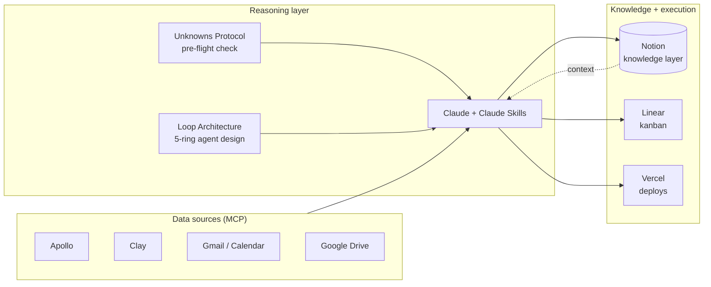
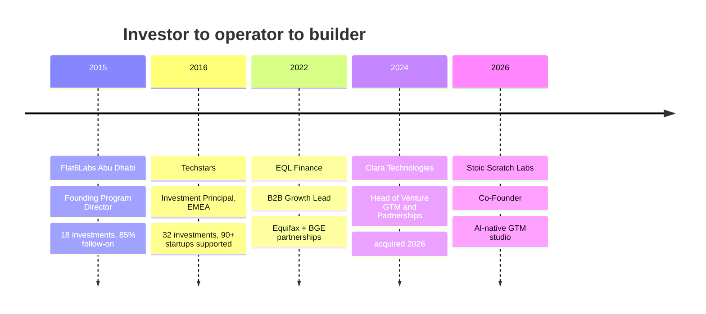

# README

# Ramzy Jamal Ismail

**Building and testing ai-native tools and workflows that support founders, operators, and investors in impacting their communities around them.**
Ex-Techstars Investment Principal · Founding Director, Flat6Labs Abu Dhabi · Co-Founder, Stoic Scratch Labs

---

## About

I spent ten years on both sides of the startup table. As an investor, I backed 50 early-stage companies across Techstars and Flat6Labs. As an operator, I was a senior GTM hire at two venture-backed startups and built the channels that drove growth. And as a founder, I co-founded Venuable (RVA Lighthouse Labs Accelerator Cohort 1), BetaPetas, and StartupUAE.com. 

Now I build the tools I wish I'd had in both roles. At **Stoic Scratch Labs**, I help SMB owners and startup founders put AI to work across sales, marketing, and partnerships: agent workflows, enrichment pipelines, research systems, and the operating playbooks around them. Trying to atleast. insert shrug.

This profile is where that work lives in public. 

> ** On operating principles and values:
    >
    >

---

## What I'm building, I think:

### RAM_OS: a personal AI operating system

The backbone for everything below. It's a set of Claude Skills, live MCP connections, and protocols that turn one operator into a small team.

### Shipped and in use

| Project | What it does | Stack | Status |
|---|---|---|---|
| **`job-search-workflow`** (Claude Skill) | 7-phase career coaching pipeline: CV audit, rewrite, gap analysis, company research, interview prep, strategy | Claude Skills, Markdown | Shipped |
| **`loop-architecture`** (Claude Skill) | Pre-build design pass for agentic systems using a 5-ring loop taxonomy, so agents get designed before they get coded | Claude Skills | Shipped |
| **`finding-your-unknowns`** (Claude Skill) | A 4-move pre-flight check that surfaces hidden assumptions before any build starts | Claude Skills | Shipped |
| **`write-clearly`** (Claude Skill) | Clear-writing framework (after Edward T. Thompson) that auto-triggers on application and outreach copy | Claude Skills | Shipped |
| **GTM Systems Library** | Outbound and partner GTM for B2B startups entering the U.S. and GCC: enrichment, sequencing, WhatsApp-first and PDPL-safe LinkedIn motions, full SOP set | Clay, n8n, WhatsApp Business API, Notion | In use |
| **MENA Signal Pipeline** | Turns raw WhatsApp community exports into a funding and regulation signal report, with a Notion regulatory register that new exports append to | Claude, Notion API | In progress |
| **MENA AI Consumer Operating Model** | 12-tab, 10,000+ formula operating model for AI subscription businesses across three Middle East markets: two-tier churn, Saudization/GOSI, Zakat, three scenarios | Excel | Shipped |
| **AI-Native Job Search System** | CV variants per role cluster, cover letters, referral mapping, and outreach drafts generated from one locked fact sheet | Claude, docx, Gmail MCP | In use |
| **PATCH NYC Hackathon 2025** | Terminal-style financial data tool for SMBs | TypeScript | Hackathon |

### Coming to this profile

- [ ] Open-source the four Claude Skills as installable repos with examples
- [ ] `gtm-playbooks`: templated partner-program and startup-program playbooks from building Clara Accelerate (20+ partners, 37% of revenue)
- [ ] `vc-memo-archive`: a structured, searchable archive of 44 real venture memos for founders and new investors
- [ ] Evals for every agent workflow, with trace logs and error analysis published alongside the code

---

## Toolbox

| Layer | Tools |
|---|---|
| **AI and agents** | Claude, Claude Code, Cowork, Claude Skills, MCP, Lovable, Replit, Kimi K2, Zhipu AI |
| **GTM data and automation** | Apollo, Clay, n8n, WhatsApp Business API, HubSpot, Salesforce |
| **Knowledge and ops** | Notion, Linear, Google Workspace, Vercel |
| **Research and intel** | Klue, Remesh |
| **Certifications** | AWS Certified AI Business Strategist (2026), Pendo AI for Product Management (2025) |

---

## How I build

1. **Find the unknowns first.** Every build starts with a pre-flight check on assumptions, constraints, and what "done" means.
2. **Design the loop before the agent.** Map inputs, decisions, feedback, and failure modes before writing a prompt.
3. **Measure the delta.** Trace logs, error analysis, and before/after measurement, or it didn't happen.
4. **Make it multiplayer.** Tools should work for a team, not just for me.
5. **Ship in public.** Work that lives in a private doc can't help anyone else.

---

## Track record

- **Techstars (2016 to 2022):** Led 32 investments and launched three accelerator investment programs in New York, Baltimore, and the UAE. Served as Techstars' first Investment Principal; previously ran portfolio services for 90+ startups and scaled EMEA portfolio services across 15 accelerator programs and cities. 
- **Flat6Labs Abu Dhabi (2015 to 2016):** Co-built the city's first $10M seed fund and equity accelerator with twofour54. Backed Washmen, the world's #1 laundry, and Unnyhog, Abu Dhabi's first Y Combinator company.
- **Clara Technologies (2024 to 2026):** Built Clara Accelerate, a program with 20+ accelerators, VCs, and venture studios that grew from 21% to 37% of revenue and lifted partner-sourced pipeline and client onboarding. Clara was acquired in Q1 2026.
- **EQL Finance (2022 to 2024):** First commercial hire. Closed partnerships with Equifax and Baltimore Gas and Electric to expand embedded financial access for AI underwriting and lending in underserved communities.

---

## Community

I firmly believe in the power of communities and the people who believe. Across various mediums of engagement and cities, I've built spaces where founders and investors connect:

- **StartupUAE Slack:** founder and investor community for the UAE and MENA. First on Product Hunt for 13:45 hours before they banned Slack community submissions.
- **Berlin 2nd Tuesdays:** recurring founder, operator, and investor meetup that spearheaded the Berlin ecosystem for a few years when Techstars had four programs in Berlin.
- **Equitech Happy Hour:** weekly gathering for Baltimore's tech community
- **TechFugees Dubai:** technology for displaced people and refugees

---

## Research

I love researching industries, products, and communities. I am naturally extra curious and like to unpack things to understand why things work. It's active learning, and connecting nodes helps me broaden my view of the impact we can have. I appreciate the venture capital industry and the ability to spot opportunity and talent in interesting spaces.

- Authored and published an independent 2016 analysis of GCC venture capital, combining MENA PE association and Wamda data with primary interviews with investors and founders, while leading Flat6Labs Abu Dhabi. Before the privilege of Magnitt data, PitchBook, Deal, and the many reports we get now.
- (https://medium.com/@ramzyis/data-on-venture-capital-in-the-middle-east-d9004230ebc4)
  
  
**Founders:** Let me know how I can help you with GTM, market expansion into the US or the GCC, fundraising, and building community-led sales motions.

---

Always building, testing, and fiddling with things.

